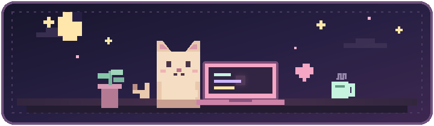
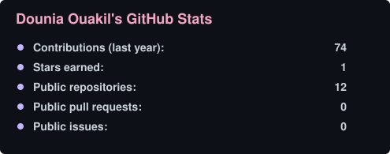

<div align="center">
  

  <h1>Hi, I'm Dounia Ouakil ୨୧</h1>

  <p>
    <strong>AI & Data Science Engineering Student</strong><br />
    turning curious ideas into useful intelligent systems, one tiny pixel at a time.
  </p>

  <p>
    <a href="https://dounia-portfolio.vercel.app/"></a>
    <a href="https://linkedin.com/in/dounia-ouakil"></a>
    <a href="https://github.com/dounia1230"></a>
  </p>
</div>

---

### `> about_me.exe`

```python
dounia = {
    "location": "Casablanca, Morocco",
    "focus": ["Generative AI", "Data Engineering", "Machine Learning"],
    "currently_exploring": ["AI Agents", "RAG", "Deep Learning"],
    "favorite_tools": ["Python", "PyTorch", "LangGraph", "Kafka"],
    "energy": "curious, rigorous, and always learning ✦",
}
```

### `> tiny_toolbox/`

<div align="center">


</div>

### `> selected_projects/`

| Project | What lives inside |
|:--|:--|
| [**SmartCampus-AI**](https://github.com/dounia1230/SmartCampus-AI) | An AI-centered project for a smarter campus experience. |
| [**multi-agents-ML**](https://github.com/dounia1230/multi-agents-ML) | Multi-agent workflows for machine-learning tasks and automation. |
| [**Agentic-BotAds**](https://github.com/dounia1230/Agentic-BotAds) | AI agents for campaign analysis, content generation, and ad compliance. |
| [**wesad_stress_project**](https://github.com/dounia1230/wesad_stress_project) | Deep-learning experiments for stress recognition from wearable signals. |
| [**real-time-fraud-detection**](https://github.com/dounia1230/real-time-fraud-detection-IEEE-CIS-) | A real-time fraud-detection pipeline built around streaming data and ML. |

### `> github_stats/`

<div align="center">
  <a href="https://github.com/dounia1230?tab=overview"></a>
  
</div>

<div align="center">
  <br />
  <sub>♡ thanks for visiting my little corner of GitHub ♡</sub>
</div>
